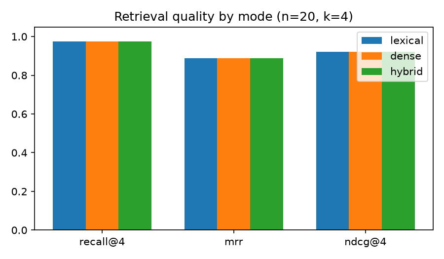
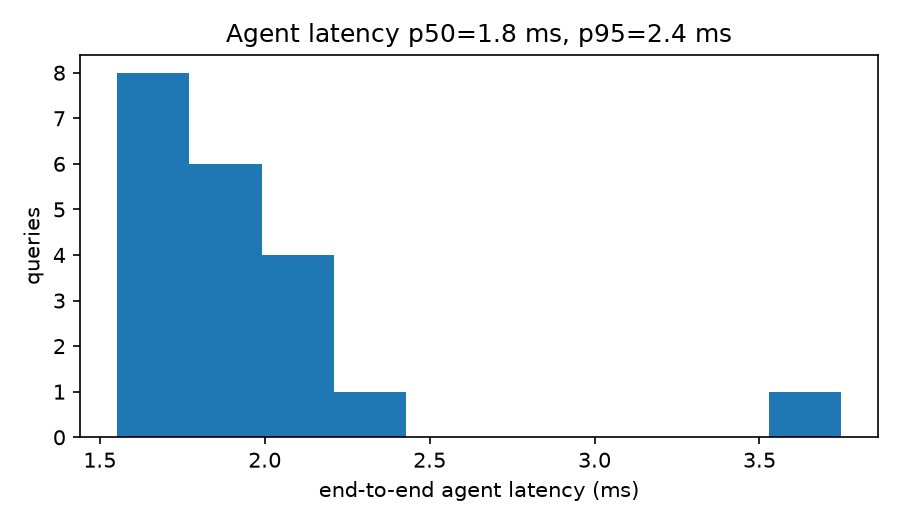

# google-fde-biomed-rag-agent

A multi-agent RAG pipeline for ultrasound QA and medical-device engineering questions. It runs offline and includes evaluation.
It answers questions over **unstructured** SOPs/methods notes and **structured** probe QA records. Every answer comes with citations, critic scores, per-agent latency traces, and an evaluation harness.

> Built by Michael Lozada-Longog (BME, Hawaiʻi Pacific University). The domain comes from my ultrasound/phantom research interests (Hele Imua).
> **Honesty note:** all documents in `data/` are synthetic teaching docs I wrote for this project. They are not regulatory or clinical guidance. Nothing here is deployed to GCP. The stack runs locally, and the section below describes how it would map to GCP.

## Quickstart
```bash
python -m venv .venv && . .venv/bin/activate
pip install -r requirements.txt
python scripts/run_demo.py            # demo Q&A + full eval + figs/
python -m biomed_rag "Which probes are flagged for review?"
python -m pytest -q                   # regression gates on eval metrics
python -m biomed_rag.api              # POST /query {"question": "..."} on :8080
```

## Architecture
```
            ┌──────────── Orchestrator (supervisor, ReAct loop, max 2 steps) ────────────┐
question →  │ Planner ─┬─> StructuredTool (CSV probe records: IDs / QA status)           │
            │          └─> Retriever ── HybridStore: FAISS (dense) + TF-IDF (lexical)   │
            │                            fused w/ Reciprocal Rank Fusion                │
            │          Synthesizer (extractive, cited; pluggable LLM interface)         │
            │          Critic (coverage + groundedness) ── reject → Retriever w/ query  │
            │                                               expansion (Thought/Action)  │
            └── Trace: per-agent spans (ms) + events → JSON  ───────────────────────────┘
```
| Module | Role |
|---|---|
| `ingest.py` | Section-aware markdown chunking (≤80 words, 1-sentence overlap). CSV rows are also indexed as text, which supports hybrid questions |
| `embed.py` | Default offline embedder: TF-IDF (1–2 grams) → LSA (TruncatedSVD), L2-normalized. Set `BIOMED_RAG_EMBEDDER=st` for sentence-transformers |
| `store.py` | FAISS `IndexFlatIP` + sparse lexical scoring + RRF fusion. Modes: `dense`, `lexical`, `hybrid` |
| `agents.py` | Planner, StructuredTool, Retriever, Synthesizer, Critic, Orchestrator |
| `telemetry.py` | Trace/span/event model (maps to Cloud Trace / Cloud Logging) |
| `evaluate.py` | Recall@4, MRR, nDCG@4 per retrieval mode; fact-hit rate, groundedness, critic retry rate, p50/p95 latency |
| `api.py` | Stdlib JSON API with `/healthz` and `/query`, using the Cloud Run `PORT` convention |

## Methods
- **Corpus:** 5 synthetic docs (phantom QA protocol, agar/gelatin fabrication SOP, probe reprocessing, acoustic output safety (MI/TI), image-quality metrics (CNR/gCNR/Dice/HD95)) plus a 5-row probe QA table. This produces 27 chunks.
- **Eval set:** `data/eval_set.json` has 20 hand-written questions. Each one lists gold `(doc, section)` relevance labels and required answer facts. Two of them are hybrid structured + unstructured questions.
- **Fact-hit:** every required fact string appears in the answer. **Groundedness:** the mean per-sentence term overlap between the answer and the retrieved context. **Coverage:** recall of query content terms in the answer.

## Results (local CPU run, `results/eval_results.json`)
| Retrieval mode | Recall@4 | MRR | nDCG@4 |
|---|---|---|---|
| lexical | 0.975 | 0.887 | 0.922 |
| dense (LSA) | 0.975 | 0.887 | 0.922 |
| hybrid (RRF) | 0.975 | 0.887 | 0.922 |

End-to-end agent results (n=20): **fact-hit 0.90**, **groundedness 0.99**, critic retry rate 0.05, latency p50 ≈ 1.8 ms and p95 ≈ 2.4 ms. There is no LLM call, because the synthesizer is extractive.

 

**Failures I found:**
- "When should a dehydrated phantom be discarded?" The extractive synthesizer picked the wrong sentences in the right chunk, so the 5% threshold was missing from the answer.
- "Maximum mechanical index?" The answer missed the 1.9 limit sentence.

Both are synthesis-ranking errors, not retrieval errors. This is the kind of problem an LLM synthesizer or a cross-encoder reranker should fix.

## Limitations (read these)
- The corpus is tiny and synthetic, and I wrote the eval questions. Results are optimistic and do not show real-world performance.
- With 27 chunks, LSA has nearly full rank, so the dense and lexical rankings come out identical. On a larger corpus the dense vs. hybrid comparison would mean something; the next step is a run with sentence-transformers / Vertex embeddings and paraphrased queries.
- The groundedness metric is lexical overlap. It is not an NLI or LLM judge.
- Nothing here is clinical advice or for regulatory use.

## How this maps to Google Cloud (not deployed)
| Local | GCP equivalent |
|---|---|
| LSA / sentence-transformers | Vertex AI text-embeddings (`text-embedding-005`) |
| FAISS IndexFlatIP | Vertex AI Vector Search (or AlloyDB pgvector) |
| CSV StructuredTool | BigQuery table behind a function-calling tool |
| Extractive synthesizer / `LLM` protocol | Gemini on Vertex AI with grounding + citations |
| Orchestrator | Vertex AI Agent Builder / ADK multi-agent graph |
| `api.py` + Dockerfile | Cloud Run service |
| `telemetry.Trace` | Cloud Trace spans + Cloud Logging structured logs |
| `evaluate.py` + pytest gates | Vertex AI Gen AI Evaluation in Cloud Build CI |

## Roadmap
LLM synthesizer behind the `LLM` protocol, cross-encoder rerank, paraphrase/adversarial eval split, image-metric tools that compute CNR/gCNR on real phantom B-mode frames.
